# octo-render

A from-scratch Rust software renderer that reimplements the core shape of an OpenGL-style pipeline: OBJ loading, vertex transforms, viewport mapping, triangle rasterization, z-buffering, shader-style fragment evaluation, shadow mapping, and screen-space ambient occlusion.


The portfolio story is intentionally split:

- `app` is the CPU software renderer and the main proof of graphics fundamentals.
- `octo-app` is an interactive `wgpu` viewer used as a GPU comparison/demo layer.

Technical notes: [software renderer write-up](docs/software-renderer.md) and [benchmark methodology/results](docs/benchmarks.md).

## Gallery

These images are generated by the CPU renderer, not by `wgpu`.

| Wireframe | Flat | Gouraud |
| --- | --- | --- |
|  |  |  |

| Textured | Normals | Shadow |
| --- | --- | --- |
|  |  |  |

| Shadow + SSAO | Depth Debug | Shadow Map Debug |
| --- | --- | --- |
|  |  |  |

Debug outputs are written under `renders/debug/`, including depth, shadow-map, normal, and AO views.

## Build And Run

```bash
cargo build --release --workspace
```

Render with the CPU software renderer:

```bash
cargo run --release --bin app -- \
  --model resources/teapot.obj \
  --shader shadow \
  --width 768 \
  --height 768 \
  --output renders/shadow-teapot.png \
  --debug-dir renders/debug/teapot-shadow \
  --cull off \
  --depth-test on \
  --depth-write on
```

Supported CPU shader modes:

```text
wireframe, flat, gouraud, texture, normal-map, shadow, ssao
```

OpenGL-style CPU render-state options:

```text
--cull off|front|back
--depth-test on|off
--depth-write on|off
--fill solid|wireframe
--texture <path>
--texture-wrap repeat|clamp
```

Texture example:

```bash
cargo run --release --bin app -- \
  --model resources/textured-quad.obj \
  --shader texture \
  --texture resources/checker.ppm \
  --output renders/textured-quad.png
```

Run the interactive GPU viewer:

```bash
cargo run --release -p octo-app
```

## Pipeline

```mermaid
flowchart LR
    OBJ["OBJ asset"] --> Parse["robust parser\ntriangulation, negative indices"]
    Parse --> Vertex["vertex transform\nmodel, view, projection"]
    Vertex --> Clip["near-plane guard"]
    Clip --> Viewport["viewport transform"]
    Viewport --> Raster["barycentric triangle rasterizer"]
    Raster --> State["render state\ncull, depth, fill, sampler"]
    State --> Fragment["fragment shader\nflat, Gouraud, texture, normals"]
    Fragment --> Shadow["shadow-map pass"]
    Shadow --> SSAO["SSAO post-process"]
    SSAO --> PNG["PNG output + debug maps"]
```



Implemented CPU features:

- Bresenham line drawing
- OBJ parser for `v`, `vt`, `vn`, and polygonal `f` faces
- Fan triangulation for quads/ngons
- Negative OBJ index support
- Perspective projection and viewport mapping
- Near-plane clipping helper and render-path rejection for fully clipped triangles
- Barycentric triangle rasterization
- Z-buffer visibility
- Explicit render state: culling, depth test/write, fill mode
- Texture sampler wrap modes: repeat and clamp
- Shader-style vertex/fragment trait
- Flat, Gouraud, checker-texture, normal-debug, shadow, and SSAO render modes
- Perspective-correct interpolation for shader varyings
- Debug outputs for depth, normals, shadow map, and AO

## Performance Snapshot

Detailed methodology and Criterion results are in [docs/benchmarks.md](docs/benchmarks.md). Short version, rendering `resources/teapot.obj` at `128x128` under Criterion:

| Mode | Triangles | Time | Throughput |
| --- | ---: | ---: | ---: |
| flat | 6,320 | 1.307 ms | 4.84M triangles/sec |
| Gouraud | 6,320 | 2.365 ms | 2.67M triangles/sec |
| shadow | 6,320 | 4.131 ms | 1.53M triangles/sec |

For more systematic measurements:

```bash
cargo bench
```

Benchmarks cover line drawing, z-buffered triangle rasterization, and full-frame software renders for flat, Gouraud, and shadow modes.

## Quality Gates

```bash
cargo fmt --check
cargo clippy --workspace --all-targets
cargo test --workspace
```

Current test coverage includes:

- OBJ parsing: quads, negative indices, malformed input
- OBJ parsing: UV and normal references
- line rasterization endpoints
- triangle coverage
- z-buffer replacement behavior
- render-state depth toggles
- culling classification
- texture sampler wrap behavior
- near-plane clipping helper
- debug outputs for depth, normals, shadow, and AO
- viewport transform
- SSAO bounds/determinism
- perspective-correct interpolation
- deterministic golden checksum and golden-image comparison

## Architecture

The workspace has two layers:

- Root package `octo-render`: CPU software-renderer library (`renderer`) plus the `app` CLI.
- `crates/*`: GPU viewer stack split into core data, asset loading, `wgpu` helpers, renderer passes, and `octo-app`.

The CPU renderer is the OpenGL-style reimplementation. The GPU viewer is intentionally separate because it delegates rasterization to `wgpu`/Metal/Vulkan/DX backends.

## Known Limitations

- Full attribute-preserving clipped-triangle emission is not implemented yet.
- Texture mode supports file textures for UV assets, but sampling is nearest-only.
- Normal-map CLI mode currently visualizes normals for no-texture OBJ assets; tangent-space normal-map asset loading is still library-level only.
- Shadow mapping uses a simple depth comparison and fixed bias.
- SSAO is deterministic and useful as a pipeline demonstration, but not physically based.
- The CPU renderer is optimized enough for portfolio evidence, not production real-time rendering.

## References

- Tinyrenderer lessons: <https://github.com/ssloy/tinyrenderer/wiki/>
- Future ray tracing direction: <https://github.com/ssloy/tinyraytracer/wiki>
