# octo-render

A from-scratch Rust software renderer that reimplements the core shape of an OpenGL-style pipeline: OBJ loading, vertex transforms, viewport mapping, triangle rasterization, z-buffering, shader-style fragment evaluation, shadow mapping, and screen-space ambient occlusion.

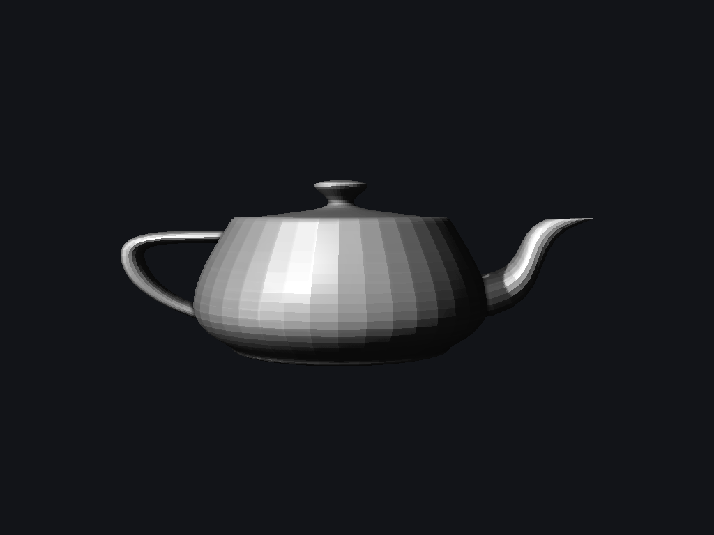

The portfolio story is intentionally split:

- `app` is the CPU software renderer and the main proof of graphics fundamentals.
- `octo-app` is an interactive `wgpu` viewer used as a GPU comparison/demo layer.

Technical notes: [software renderer write-up](docs/software-renderer.md), [case study](docs/case-study.md), [benchmark methodology/results](docs/benchmarks.md), [profiling notes](docs/profiling.md), and [tinyrenderer/Habr comparison](docs/tinyrenderer-comparison.md).

## Gallery

These images are generated by the CPU renderer, not by `wgpu`. `scripts/render-gallery.sh` holds the exact command for every image and regenerates them all.

| Wireframe | Flat | Gouraud | Specular |
| --- | --- | --- | --- |
| 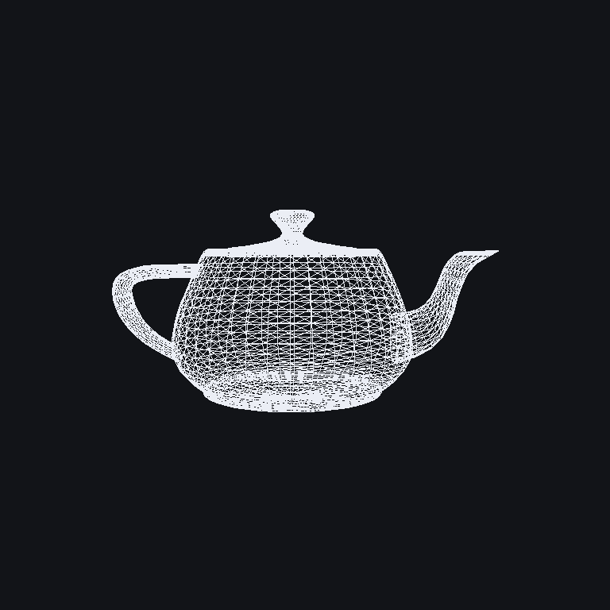 | 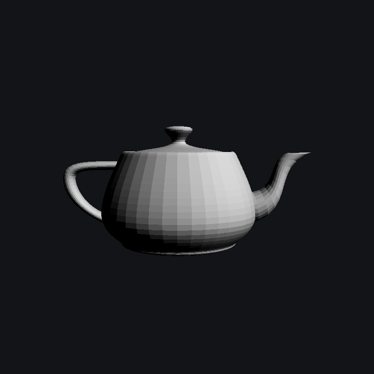 | 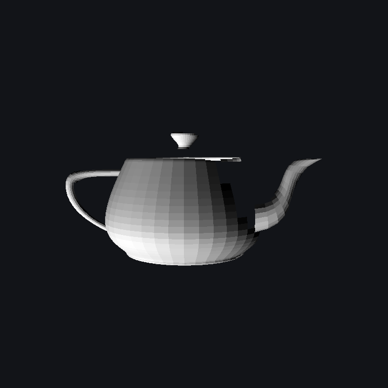 | 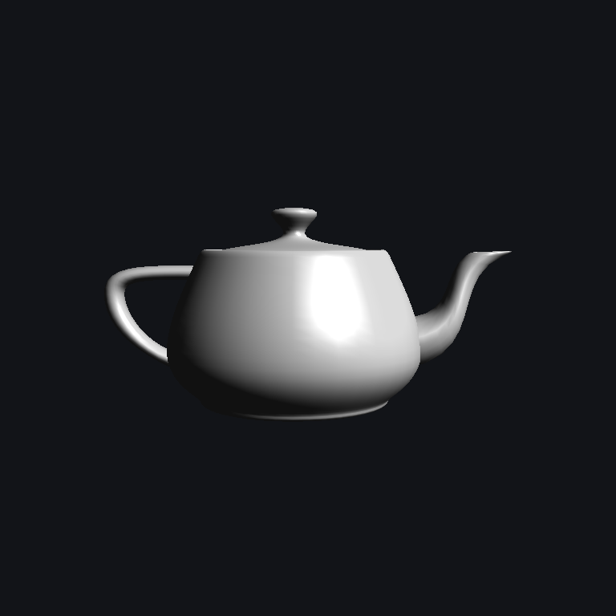 |

| Textured | Normal Map | Normal Debug |
| --- | --- | --- |
| 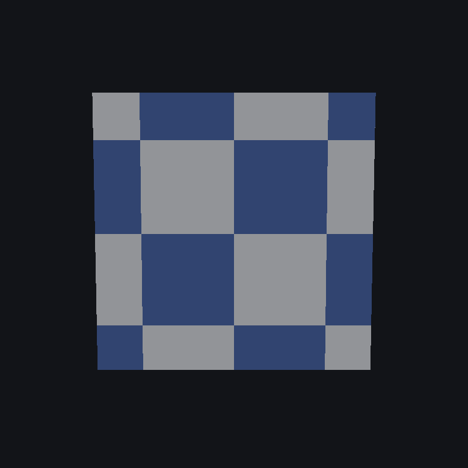 | 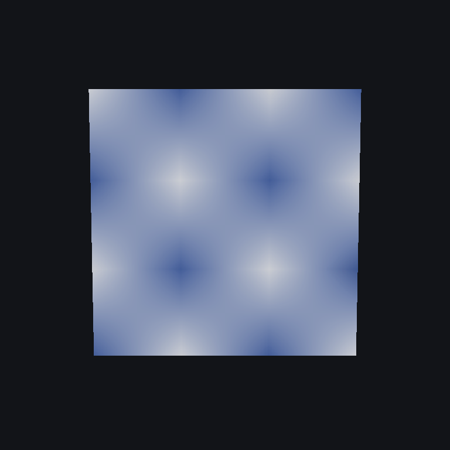 | 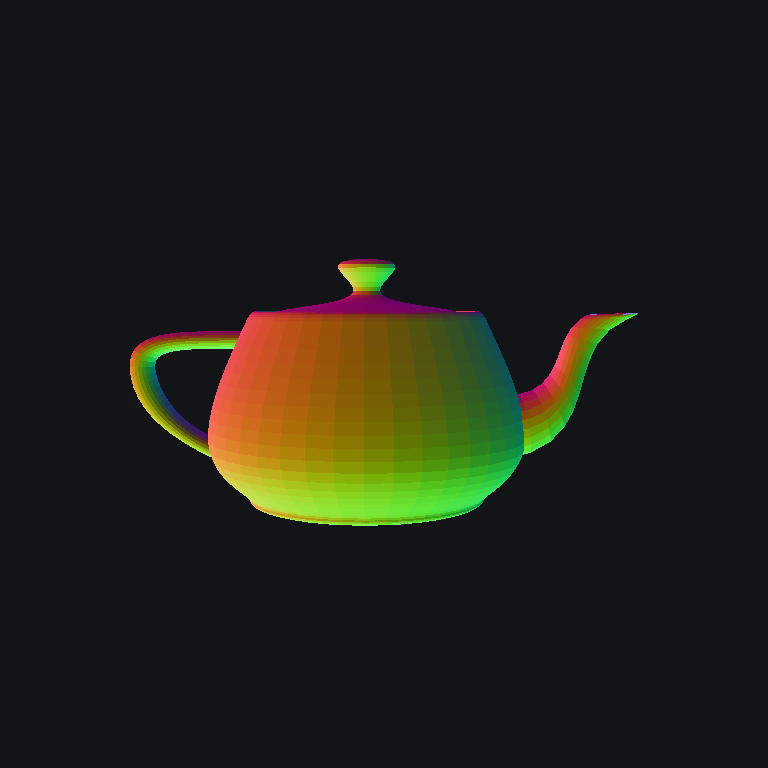 |

| Shadow | Shadow PCF | Shadow + SSAO |
| --- | --- | --- |
| 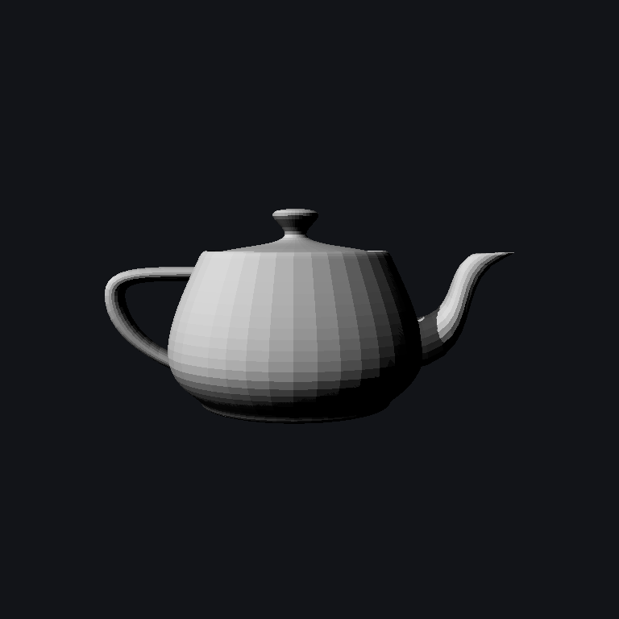 |  | 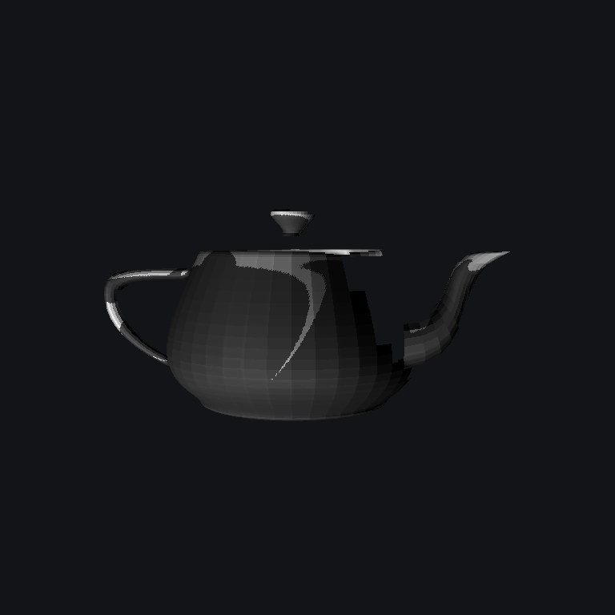 |

| Depth Debug | Shadow Map Debug | AO Debug |
| --- | --- | --- |
| 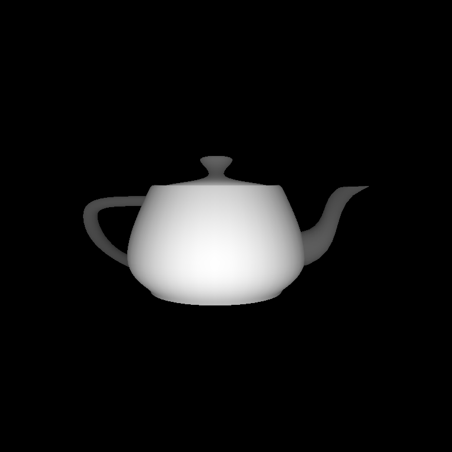 | 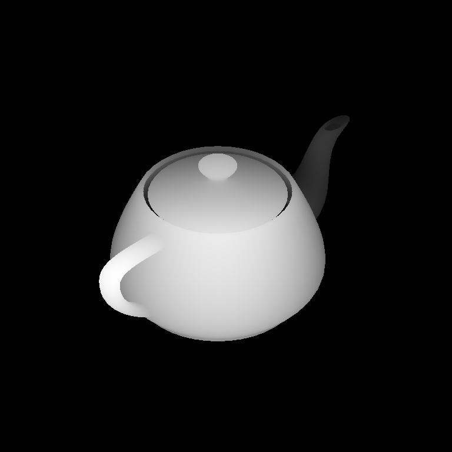 | 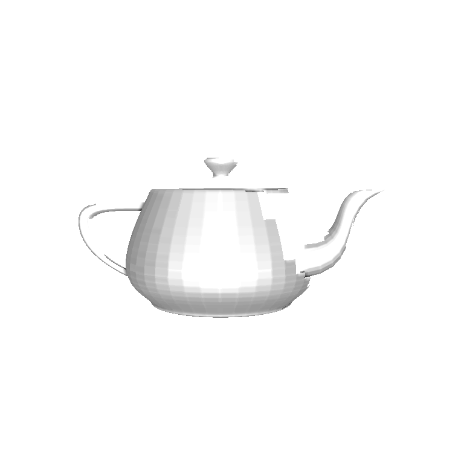 |

| Frustum Clip | Alpha Blend | Mipmap | MTL Material |
| --- | --- | --- | --- |
| 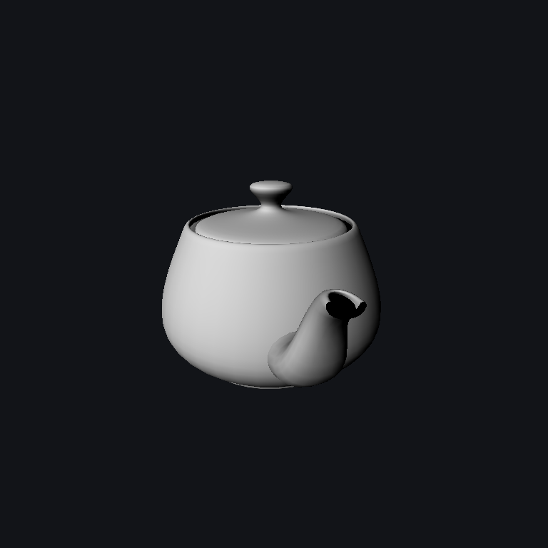 | 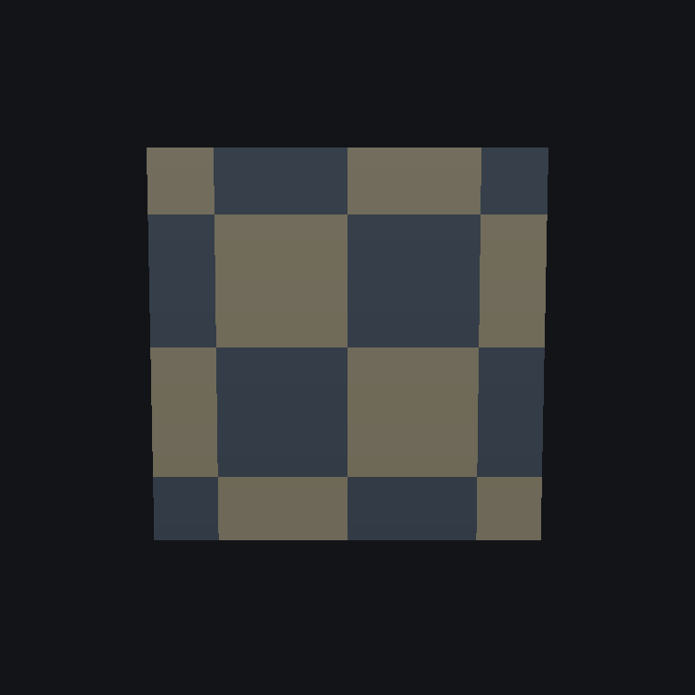 | 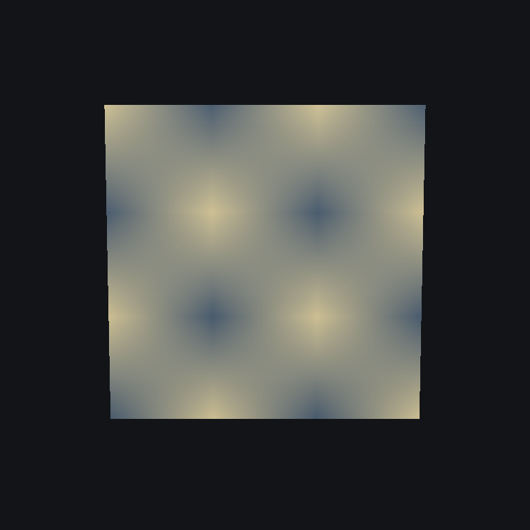 | 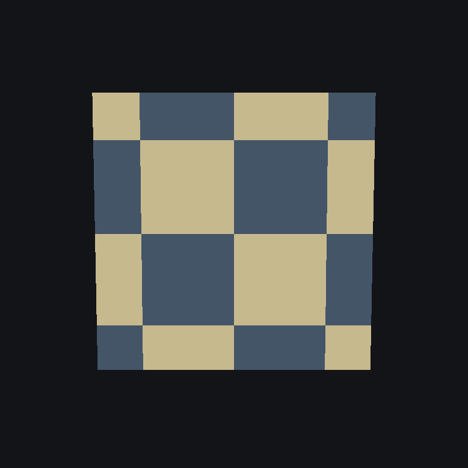 |

Debug outputs are written under `renders/debug/`, including depth, shadow-map, normal, and AO views.

## Build And Run

```bash
cargo build --release --workspace
```

Render with the CPU software renderer:

```bash
cargo run --release --bin app -- \
  --model resources/teapot.obj \
  --shader shadow \
  --width 768 \
  --height 768 \
  --light=-1,1,1 \
  --output renders/shadow-teapot.png \
  --debug-dir renders/debug/teapot-shadow
```

Regenerate the whole gallery:

```bash
scripts/render-gallery.sh
```

Supported CPU shader modes:

```text
wireframe, flat, gouraud, texture, normal-map, normal-debug, shadow, ssao
```

Scene options:

```text
--camera x,y,z        camera eye in normalized scene space [default: 0,0.25,3]
--light x,y,z         direction toward the light, scene space [default: 1,1,1]
```

The single `--light` vector drives diffuse shading, specular highlights, and the shadow-map camera, so shading and shadows always agree.

OpenGL-style CPU render-state options:

```text
--cull off|front|back
--front-face ccw|cw
--depth-test on|off
--depth-write on|off
--fill solid|wireframe
--scissor x,y,width,height
--clear-color r,g,b
--clear-depth <z>
--color-write on|off
--blend off|alpha|additive
--texture <path>
--texture-wrap repeat|clamp
--texture-filter nearest|linear|mipmap
--normal-map <path>
--material <name>
--base-color r,g,b
--ambient <value>
--diffuse <value>
--specular <value>
--shininess <value>
--alpha <value>
--shadow-size <px>
--shadow-bias <z>
--shadow-filter none|pcf
```

Texture example:

```bash
cargo run --release --bin app -- \
  --model resources/textured-quad.obj \
  --shader texture \
  --texture resources/checker.ppm \
  --output renders/textured-quad.png
```

Normal-map example:

```bash
cargo run --release --bin app -- \
  --model resources/textured-quad.obj \
  --shader normal-map \
  --texture resources/checker.ppm \
  --normal-map resources/normal-checker.ppm \
  --texture-filter linear \
  --light 0,0,1 \
  --ambient 0.05 \
  --output renders/normal-map-quad.png
```

Run the interactive GPU viewer:

```bash
cargo run --release -p octo-app
```

## Pipeline

```mermaid
flowchart LR
    OBJ["OBJ asset"] --> Parse["robust parser\ntriangulation, negative indices"]
    Parse --> Vertex["vertex transform\nmodel, view, projection"]
    Vertex --> Clip["attribute-preserving\nsix-plane frustum clipping"]
    Clip --> Viewport["viewport transform"]
    Viewport --> Raster["barycentric triangle rasterizer"]
    Raster --> State["render state\ncull, depth, fill, scissor, blend"]
    State --> Fragment["fragment shader\nflat, Gouraud, texture, normal map,\nBlinn-Phong specular"]
    Fragment --> Shadow["shadow-map pass\nbias, size, PCF"]
    Shadow --> SSAO["SSAO post-process"]
    SSAO --> PNG["PNG output + debug maps"]
```

Implemented CPU features:

- Bresenham line drawing
- OBJ parser for `v`, `vt`, `vn`, polygonal `f` faces, `mtllib`, and `usemtl`
- Smooth vertex normals for meshes without `vn`: positions are welded, face normals are angle-weighted, and edges sharper than a crease angle stay hard (`--crease-angle`, default 60°)
- MTL parser for `Ka`, `Kd`, `Ks`, `Ns`, alpha, diffuse maps, and normal-map keys
- Fan triangulation for quads/ngons
- Negative OBJ index support
- Perspective projection and viewport mapping
- Attribute-preserving six-plane frustum clipping before viewport transform
- Barycentric triangle rasterization
- Deterministic top-left triangle fill rule with pixel-center sampling
- Z-buffer visibility
- Explicit render state: culling, front-face winding, depth test/write, fill mode, scissor, clear state, color write, and blending
- Back-face culling before clipping, from the sign of the homogeneous `(x, y, w)` determinant, so culled faces skip clipping and vertex shading
- Blend modes: off, source-over alpha, additive
- Texture sampler wrap/filter modes: repeat, clamp, nearest, linear, simplified mipmap LOD
- Material controls for base color, ambient, diffuse, specular, shininess, alpha, MTL defaults, and CLI overrides
- Blinn-Phong specular: per-face in flat mode, per-vertex in Gouraud/texture/shadow modes, per-pixel in normal-map mode, and suppressed inside shadows
- One world-space light vector shared by diffuse shading, specular, and the shadow-map camera
- Shader-style vertex/fragment trait
- Flat, Gouraud, checker/file texture, normal-map, normal-debug, shadow, and SSAO render modes
- Perspective-correct interpolation for shader varyings
- Configurable shadow-map size, bias, and PCF filtering
- Debug outputs for depth, normals, shadow map, and AO

## OpenGL-Style Coverage

| Area | Status | Notes |
| --- | --- | --- |
| Vertex transform | Implemented | Rust matrix path for model/view/projection/viewport |
| Frustum clipping | Implemented | Six-plane clipping in the renderer's projection convention; emitted vertices preserve varyings |
| Triangle rasterization | Implemented | Barycentric rasterizer with top-left fill rule and pixel-center sampling |
| Depth buffer | Implemented | Clear depth, depth test, and depth write state |
| Render state | Implemented subset | Culling, winding, fill, scissor, color write, blend, sampler, shadow options |
| Textures | Implemented subset | PPM/loaded images, repeat/clamp, nearest/linear/mipmap sampling |
| Materials | Implemented subset | OBJ/MTL material loading plus CLI overrides |
| Fragment shading | Implemented subset | Fixed Rust shader structs (Lambert + Blinn-Phong), not GLSL/SPIR-V |
| Shadows/post-process | Implemented subset | Shadow map, PCF, SSAO, and debug maps |
| Not claimed | Out of scope | Stencil, MSAA, cubemaps, instancing, programmable shader language, full OpenGL conformance |

## Performance Snapshot

Detailed methodology and Criterion results are in [docs/benchmarks.md](docs/benchmarks.md). Short version, rendering `resources/teapot.obj` at `128x128` under Criterion after culling moved ahead of clipping (Linux, Intel Xeon @ 2.10 GHz, single-threaded):

| Mode | Triangles | Time | Throughput |
| --- | ---: | ---: | ---: |
| flat | 6,320 | 1.4350 ms | 4.40M triangles/sec |
| Gouraud | 6,320 | 2.0826 ms | 3.03M triangles/sec |
| shadow | 6,320 | 3.6268 ms | 1.74M triangles/sec |

These are not comparable with the July macOS numbers in the same doc. The doc's later sections compare before and after on one machine for each change.

For more systematic measurements:

```bash
cargo bench
```

Benchmarks cover line drawing, z-buffered triangle rasterization, full-frame software renders, clipped vs unclipped triangles, back-face culling, texture filters, shadow filters, and resolution scaling.
They also cover blending and mipmap sampling variants.

## Quality Gates

```bash
cargo fmt --check
cargo clippy --workspace --all-targets
cargo test --workspace
```

Golden images live in `tests/golden/`. After an intentional pixel change, rewrite them with `UPDATE_GOLDENS=1 cargo test -p octo-render golden` and review the image diff before committing.

Current test coverage includes:

- OBJ parsing: quads, negative indices, malformed input
- OBJ parsing: UV, normal, MTL, and material references
- line rasterization endpoints
- triangle coverage
- top-left shared-edge fill behavior
- z-buffer replacement behavior
- render-state depth toggles
- culling classification, including a seeded property test that the clip-space winding test agrees with screen-space winding, and a floor triangle that crosses behind the eye
- culled teapot renders pinned bit-for-bit (image and depth) across the culling refactor
- texture sampler wrap behavior
- texture sampler linear and mipmap filtering
- alpha and additive blending
- attribute-preserving frustum clipping
- scissor and color-write state
- front-face winding state
- normal-map texture path
- Blinn-Phong specular: highlight peak, back-light rejection, and render-level highlight
- unlit surfaces still write depth in every lit mode
- faces without UVs do not inherit the previous face's texture coordinates
- generated normals: cube corners with and without a crease limit, welding of duplicated vertices, flat grids, authored `vn` left alone, and unit outward normals on the teapot
- an occluder casts a shadow, and PCF changes the shadow edge
- the shadow pass ignores camera raster state (scissor, culling, depth writes, blending)
- shadow-map size/filter options
- debug outputs for depth, normals, shadow, and AO
- viewport transform
- SSAO bounds and run-to-run determinism
- perspective-correct interpolation
- deterministic golden checksum and golden-image comparison

## Architecture

The workspace has two layers:

- Root package `octo-render`: CPU software-renderer library (`renderer`) plus the `app` CLI.
- `crates/*`: GPU viewer stack split into core data, asset loading, `wgpu` helpers, renderer passes, and `octo-app`.

The CPU renderer is the OpenGL-style reimplementation. The GPU viewer is intentionally separate because it delegates rasterization to `wgpu`/Metal/Vulkan/DX backends.

## Known Limitations

- Frustum clipping is implemented for this renderer's projection path, but it is not a full OpenGL conformance clipper.
- Mipmap LOD uses a simplified screen-space triangle estimate, not GLSL derivatives.
- Normal-map mode consumes either a CLI normal-map texture or an MTL normal-map key; tangent generation remains minimal.
- Moving `--camera` closer strengthens perspective but does not enlarge the model. The view matrix puts the eye at the view-space origin, while the projection places its centre of projection one camera-distance further back. Fixing this reframes every render and the clipping tests, so it is tracked as follow-up work.
- The bundled textures are 4x4 PPMs, so the textured and mipmap gallery images show magnification; demonstrating minification needs a larger texture.
- Shadow mapping supports configurable bias and simple 3x3 PCF, but not cascades or slope-scaled bias.
- SSAO is deterministic and useful as a pipeline demonstration, but not physically based. It compares raw depth against a fixed threshold without using normals, so curved surfaces pick up faint per-triangle bands.
- Blending supports alpha and additive modes, but not full `glBlendFunc`/`glBlendEquation` configurability.
- The CPU renderer is optimized enough for portfolio evidence, not production real-time rendering.

## References

- Tinyrenderer lessons: <https://github.com/ssloy/tinyrenderer/wiki/>
- Future ray tracing direction: <https://github.com/ssloy/tinyraytracer/wiki>
