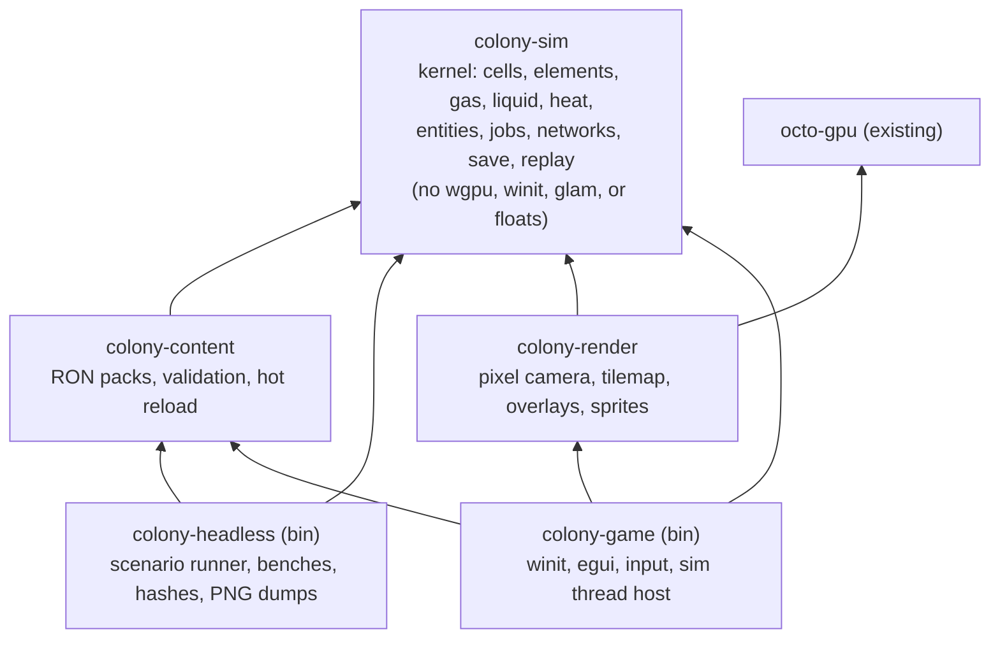
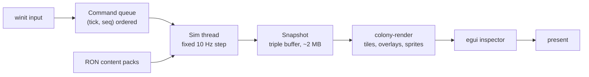
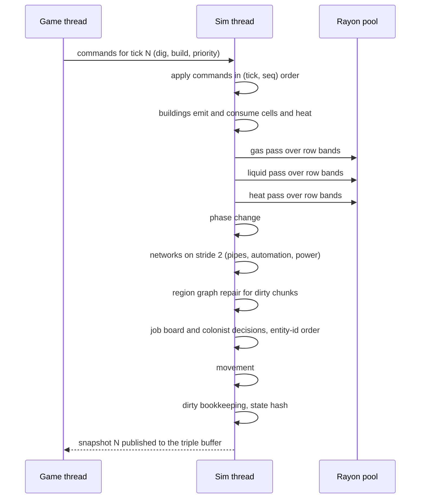
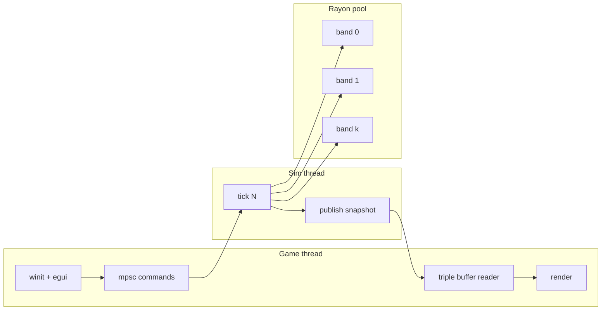

# Colony Engine Design And Roadmap

Status: design written 2026-11-03; M1 (the headless kernel), M2 (fluids, worldgen, snapshots, replay), and M3 (the windowed renderer) landed the same day under `colony/`, see the results in section 14. This document is the research record, the architecture, and the milestone plan for a purpose-built 2D colony-simulation engine that grows next to `octo-render`. `colony-sim`, `colony-headless`, `colony-render`, and `colony-game` exist; `colony-content` remains a placeholder name.

The portfolio story stays split. `octo-render` proves graphics fundamentals on the CPU. The colony engine is a separate product whose proof is a deterministic, benchmarked cell simulation.

## 1. Problem And Goals

Purpose-built engines own one genre and make its content cheap to author: RPG Maker (classic JRPGs, more than 800 games on Steam), Ren'Py (visual novels), Adventure Game Studio (point-and-click), GB Studio (Game Boy-constrained adventures), Pixel Game Maker MV (action), SRPG Studio (tactics). Reimplementation engines such as GemRB, OpenXcom, and JA2 Stracciatella show the same shape from the other direction: one genre, data-driven content, a small runtime. Nobody ships a maker for simulation-driven colony games. The reference titles (Oxygen Not Included, RimWorld, Dwarf Fortress, Songs of Syx, Factorio, Noita) each own a custom simulation core, whether or not they sit on Unity.

Goals:

- A 2D side-view colony game in the Oxygen Not Included mould: a tile world where every cell holds one element with a mass and a temperature; gases diffuse, liquids fall and spread, heat conducts; colonists dig, build, and keep a base breathable; buildings join power, pipe, and automation networks. Pixel art.
- The user's own game first. Everything that is content lives in data files from day one, so a general tool (editor, mod loader) can be extracted once the game proves the design.
- A thin custom Rust core on `wgpu` that reuses `octo-render`'s GPU plumbing, with the simulation kernel as a crate that knows nothing about windows or GPUs.
- A deterministic, replayable simulation, pinned by tests the way `octo-render` pins its renders.

Non-goals: 3D, multiplayer, dialogue systems, infinite streaming worlds, a general-purpose scene editor.

## 2. Why This Genre And This Stack

### 2.1 Candidate genres

| | Disco Elysium-like isometric CRPG | Silent Storm-like 3D tactics | Oxygen Not Included-like colony sim |
| --- | --- | --- | --- |
| Core tech | Pre-rendered colour and depth backgrounds, real-time characters composited against them, click-to-move, a branching-dialogue runtime | Full 3D, destructible buildings, projectile penetration, ragdolls | Per-cell element, mass, and heat simulation; pathfinding and jobs; networks |
| Where the work is | Narrative tooling and the paint-over art pipeline; ZA/UM's 1.2 M words outgrew articy:draft | Physics and destruction; years of engine work at Nival | The simulation kernel: cache-bound grid updates, determinism, threading |
| Engine vs. content | Content-dominated; the engine is mostly a dialogue VM | Engine-dominated, 3D | Engine-dominated, 2D |
| Solo feasibility | Yes, but the art is the cost | Not from scratch | Yes: tiles and sprites are cheap, the sim is a bounded systems problem |
| Pixel-art fit | Weak (painterly) | Weak | Strong: the tile grid is the sim grid |
| Fit with `octo-render` | It could bake backgrounds | None | Same working style: measured, test-pinned, benchmarked |

### 2.2 The case for the colony sim

The differentiating technology is a compact systems problem: a few hundred thousand cells updated at a fixed rate, with exact conservation, chunk-level dirty tracking, and a sim thread decoupled from rendering. That is benchmarkable with Criterion, pinnable with golden images and state hashes, and explainable in a write-up, which is exactly how `octo-render` was built. Rendering is tiles and sprites. The art budget is a tileset and a handful of sprite sheets, not painted scenes. Custom engines are the norm when the core mechanic *is* the simulation (Noita, Factorio, Dwarf Fortress); the usual advice against rolling an engine applies to games whose engine work is undifferentiated.

The RimWorld-like top-down colony sim was considered as a simpler cousin. It drops the fluid simulation but keeps jobs, needs, regions, and a storyteller. The design below is a superset: the job and needs layer sits on top of the cell kernel either way, so starting with the kernel does not close that door.

### 2.3 Why a custom Rust core on wgpu

- **Bevy 0.19** (August 2026) is the strongest Rust engine, but it still ships no editor, its new scene notation has no asset loader yet, and it breaks APIs roughly every three months (the 0.19 to 0.20 migration guide already changes the scene syntax). A long-running solo project would spend a noticeable share of its time on migrations.
- **Godot 4**'s scene tree is designed for moderate numbers of complex nodes; an open proposal acknowledges it is inefficient for tens of thousands of simple entities. The simulation would have to live in a native extension anyway, at which point Godot is only the renderer and UI.
- **Fyrox 1.0** has a real editor, but a 3D-first scene model and a small ecosystem.
- `octo-render` already has the `wgpu` 24, `winit` 0.30, and `egui` 0.31 plumbing in `crates/gpu` and `crates/app`, plus a testing and benchmarking culture that transfers directly.

The kernel is kept engine-agnostic (no `wgpu`, `winit`, or `glam` dependency), so hosting it inside Bevy later remains a one-crate adapter rather than a rewrite.

### 2.4 What octo-render provides

Borrowed as the starting point: `GpuContext`, `GpuBuffer`, and `GpuTexture` from `crates/gpu`; the `winit` `ApplicationHandler` plus `egui` side-panel wiring in `crates/app/src/main.rs`; the offscreen-framebuffer-plus-fullscreen-blit pattern in `crates/renderer`; golden-image tests with tolerance; Criterion benches; a CI of `fmt`, `clippy`, and `test`.

Not reused: the CPU rasterizer, the 3D shadow and forward passes, `OrbitCamera`, and both OBJ loaders. Missing entirely and built new: an orthographic pixel camera, tile and sprite batching with per-instance data, an atlas with nearest filtering, frame timing and a fixed step, input mapping, an entity store, and a content pipeline.

## 3. Prior Art

### 3.1 Oxygen Not Included (Klei)

Unity and C# for the game layer, with the simulation in a native C++ library (`SimDLL`) that runs on its own thread and exchanges messages with the game. A Klei developer described the sim's cost as "almost entirely cache and memory fetching", not arithmetic. Each cell holds exactly one element (one gas *or* one liquid *or* one solid) with a mass and a temperature; gases do not mix and a gas and a liquid never share a cell. Heat is conserved; heat transfer depends on the temperature difference and the two conductivities with cell-type multipliers; liquids cannot exist below 10 g per cell outside pipes; stacked liquid adds roughly 1% of the mass above as pressure to the cell below. Content is data-driven (YAML under `StreamingAssets`, including worldgen temperatures and world dimensions; a 256×384 world is the common reference, and players who edited a world to 512×512 crashed the game). Mods patch the C# layer with Harmony; the native sim is effectively unmoddable. Worldgen determinism was something Klei had to fix after launch.

### 3.2 Noita (Nolla Games)

A falling-sand world split into 64×64 simulation chunks, each with a dirty rectangle so idle chunks cost nothing. Updates are multithreaded over regions scheduled so that neighbouring regions never update concurrently (a checkerboard of passes). World streaming uses larger 512×512 chunks. The lesson for a finite colony world is the dirty tracking and the phased scheduling, not the streaming.

### 3.3 RimWorld (Ludeon)

A* over a map divided into regions of roughly 12×12 cells, so long paths are planned region to region before tile detail is filled in. An AI storyteller modelled on Left 4 Dead's director paces events. The job system is the template for colonist behaviour: a prioritised board of work, colonists pick by priority and distance, reservations stop two colonists from taking the same task.

### 3.4 What is copied and what is not

| Copied | Deliberately not copied |
| --- | --- |
| Simulation on its own thread behind a message boundary (ONI) | Floating-point cell state (ONI): this engine needs replayable saves |
| One element per cell with mass and temperature (ONI) | A native, closed sim that mods cannot reach (ONI): the sim is data-driven and will expose event hooks |
| Minimum liquid mass, pressure from stacked liquid, conductivity rule (ONI) | Harmony-style code patching as the modding model |
| Dirty chunks and phased multithreading (Noita) | Infinite streaming worlds (Noita) |
| Region graph for pathfinding, job board with reservations (RimWorld) | A general scene tree or node system |

## 4. Market Context

These figures come from web-search summaries of third-party trackers and were not re-verified against the source pages, which were unreachable from the session's network. Treat them as approximate; they inform scope, not design.

- Steam's "Colony Sim" tag (Steam Page Analyzer niche report, captured late September 2026): 151 releases in 2024, 221 in 2025, and 251 so far in 2026, with 1,079 further unreleased store pages. About 13.7% of recent colony sims reached 1,000 reviews, against 4.2% for Steam as a whole. Most are priced $5–9.99, but the $20-and-up band performed best. The median revenue for colony and management games with 100 or more reviews is estimated at $150k–400k.
- The "Pixel Graphics" tag (a Substack analysis of 6,422 games released August 2023 to August 2025): about 5% reached 500 reviews; turn-based and strategy titles were the strongest pixel subgenres.
- Indie games overall earned roughly $4.4B on Steam in 2025, about 25% of the platform. Only around 300 of roughly 20,000 releases passed $1M, and the median is tiny.
- The pixel aesthetic has momentum: Square Enix's HD-2D line continues (Final Fantasy Resonance announced for October 2026), and 2026 commentary describes a pixel-art boom. This is qualitative.

Takeaways: the niche is crowded but converts better than Steam's average; differentiation must come from the simulation, not the art style; plan for a $20-class product; ship a playable vertical slice before polishing the engine.

## 5. Architecture Overview



Dependencies point strictly downward. CI runs `cargo tree -p colony-sim` and fails if `wgpu`, `winit`, or `glam` appear.



## 6. Simulation Kernel (`colony-sim`)

### 6.1 Cell storage

The world is finite and fully resident. Cells live in flat, row-major structure-of-arrays buffers over the whole world, so a neighbour is `i ± 1` or `i ± W` with no chunk-edge special cases. Chunks of 32×32 cells exist only for scheduling and dirty tracking.

| Field | Type | Notes |
| --- | --- | --- |
| `element` | `u16` | index into the element table |
| `mass` | `u32` | Q16.16 kg |
| `temp` | `i32` | Q16.16 K |
| `flags` | `u8` | solid, settled, has-building, reserved |
| double buffers of `element`, `mass`, `temp` | | written by the current pass, swapped at pass end |
| `occupant` | `u32` | building or item entity, cold |
| `light` | `u8` | cold |
| per-chunk `active` bitset | | one bit per chunk |

Budget: 32 bytes per cell. A 512×512 world (262,144 cells) is about 8 MB; the reference ONI world is 256×384. Limits are sized so a 1024×1024 world (32 MB) still works. A chunk's hot data (32×32 × 11 B ≈ 11 KB) fits in L1, which matters because the reference implementation is memory-bound, not compute-bound.

### 6.2 Numbers: fixed point

All kernel state is integer. Mass is `u32` in Q16.16 kilograms (maximum 65,535 kg per cell, resolution about 15 mg). Temperature is `i32` in Q16.16 kelvin. Intermediate products use `i64`. Content files are authored in human units as floats and converted once at load time inside `colony-content`; the kernel never sees a float.

Reasons: bit-exact results across CPUs, compilers, and SIMD or FMA settings; exact mass conservation (an integer that leaves one cell is the same integer that enters the other); four-byte lanes that vectorise well. The reference game uses floats, but it never promised replayable saves.

Two rules that silently break conservation if forgotten:

- An arithmetic right shift of a negative product rounds toward negative infinity. Every antisymmetric flux must be computed as `sign(d) * ((|d| * K) >> 16)` so both endpoints produce the same magnitude.
- Rounding in `ΔT = dQ / (mass·shc)` is per cell. Energy is conserved to one least-significant bit per exchange, and a global ledger test bounds the drift over long runs.

A mass floor removes the reference game's micro-gas residue: a cell whose mass drops below 1 g sends all of it to its largest same-element neighbour (deterministic tie-break) and becomes vacuum.

### 6.3 Tick model

One fixed simulation step at 10 Hz (100 ms of game time). Game speed ×2 and ×3 run more steps per wall second; the step length never changes. The reference game steps its sim at 5 Hz. The renderer draws cells from the newest snapshot and interpolates entity positions between the last two.



Budget: a full tick at 512×512 must stay under 20 ms on one core, so ×3 speed fits in a single core and the second core is headroom.

### 6.4 Threading



The sim runs on its own `std::thread`. The game thread sends `Command` values over an `mpsc` channel; the sim publishes a `Snapshot` (element ids, flags, quantised mass and temperature for overlays, entity poses, about 2 MB at 512×512) through a triple buffer so the renderer never waits.

Inside a pass the kernel uses a **gather formulation with a double buffer**: every flux or swap is computed from the old buffer by both endpoint cells, and each cell writes only its own new value. Passes are therefore a plain `rayon` `par_chunks_mut` over row bands of the write buffer, with no checkerboard scheduling and results identical to a single-threaded run. Pairwise swaps (a liquid falling through a gas, a heavy gas displacing a light one) use **mutual proposal**: each cell proposes at most one partner by a fixed priority (down, left, right, up), and a swap happens only when both cells propose each other. Because each cell has at most one partner, no cell is in two swaps.

Noita's two- and four-phase checkerboard is documented as the fallback if a scatter-style update is ever needed. Chunks whose 3×3 neighbourhood had no exchange last tick are skipped. Activity is tracked separately for the mass passes (sort and flux, which never read temperature) and for the heat pass, so a solid region that is only conducting heat costs nothing in the mass passes. On a quiet base most of the world is skipped in every pass.

### 6.5 Gas

One gas per cell; pressure is mass. For each of the four neighbours that holds the same gas, or is vacuum:

```text
for each cell a, reading only the OLD buffers:
    out = 0; inflow = 0
    for b in [down, left, right, up]:
        if same_gas(a, b) or vacuum_accepts(b, a) or vacuum_accepts(a, b):
            d = mass_old[a] - mass_old[b]          // i64
            f = (abs(d) * K) >> 16                 // K = 0.25 in Q16.16
            if d > 0 { out += f } else { inflow += f }
    mass_new[a] = mass_old[a] - out + inflow
```

With `K ≤ 1/4` the four outbound fluxes sum to at most the cell's mass, so no cell goes negative. Both endpoints compute the same `f`, so the world total is exactly constant; a debug assertion checks it every tick. A vacuum cell accepts gas only from its highest-mass gas neighbour (ties by the priority order), and every sender evaluates the same rule for the vacuum cell, so the winner is agreed without communication. Two different gases never exchange mass directly. They interact through two rules that both terminate.

- **Buoyancy sort**, a pass of its own before flux: a gas cell proposes to swap with the cell below if that holds a lighter gas, otherwise with the cell above if that holds a denser one. A swap happens only when the two cells propose each other, and each swap removes one density inversion, so sorting cannot oscillate.
- **Pressure evacuation.** The sort pass also flags a gas cell as *pressed* when a different gas next to it has more than twice the mean mass of the cell and its same-gas neighbours. Comparing against that regional mean rather than the cell alone keeps a freshly filled interface cell, which starts thin, from being pushed straight back. In the flux pass a pressed cell sends all of its mass to its heaviest unpressed same-gas neighbour and becomes vacuum, which the heavier gas fills next tick. Mass only ever moves into the gas's own region, so the interface advances until the regional pressures are within a factor of two, then stops.

The design first proposed a direct swap between a heavy cell and a light cell of different gases. The first golden image showed why that is wrong: the displaced light cell is still under pressure inside the heavy region, swaps again every tick, and the two gases end up as marching one-cell stripes that never settle.

### 6.6 Liquid

Liquids share the sort and flux passes with gases (implemented in M2):

- **Fall.** The buoyancy sort covers every fluid: a liquid above a gas or a vacuum swaps with it under mutual proposal, and denser liquids sink below lighter ones. A liquid above a same-element liquid pours down up to a quarter of its mass per tick, as much as the lower cell can take below its `max_mass` (1,000 kg for water).
- **Spread.** Sideways, a quarter of the level difference flows toward the lower same-element cell, capped so the receiver never exceeds `max_mass`. A liquid of at least 80 g beside a gas cell presses it: the gas evacuates into its own region, and the liquid spreads a quarter of its mass into the vacuum next tick.
- **Over-pressure.** A cell more than 10 g above `max_mass` pushes up to a quarter of its excess into the cell above (pressing a gas there out of the way). Smaller overfills are tolerated, because pushing them up would only create sub-floor residue that merges straight back down and never settles.

Each flow is budgeted at a quarter of the cell (down, left, right, up), so the four together can never exceed its mass. Liquids and gases never share a cell, and a liquid cell below 10 g merges into its heaviest same-element neighbour. The stacked-liquid pressure that damages weak tiles is deferred to the buildings milestone.

### 6.7 Heat and phase change

```text
for each cell a, reading only the OLD buffers:
    dq = 0
    for b in neighbours(a):
        k = min(cond[el_a], cond[el_b]) * pair_mult(kind_a, kind_b)   // gas-gas 1, solid-gas 25, ...
        dt = temp_old[b] - temp_old[a]                                 // i64
        q = sign(dt) * ((abs(dt) * k * STEP) >> 32)
        // never move more than half of what would equalise a and b
        q_max = (abs(dt) * C_a * C_b / (C_a + C_b)) / 2               // C = mass * shc
        q = clamp_abs(q, q_max)
        dq += q
    temp_new[a] = temp_old[a] + dq / C_a
```

The clamp makes the explicit scheme unconditionally stable without a smaller step. Vacuum conducts nothing. Buildings are heat bodies with their own mass and temperature, coupled to the cells they occupy. Phase change runs at the end of the heat pass on the cell's new temperature (it is cell-local, so it needs no pass of its own): the element's melt and boil points with a ±3 K hysteresis band decide whether the cell becomes its solid, liquid, or gas form; the mass does not change and there is no latent heat (the reference game makes the same simplification). A phase change marks the chunk active for every pass, since the mass passes do not otherwise watch the heat pass.

### 6.8 Conservation and the gather rule

The whole kernel follows one rule: a cell's new value depends only on old values of itself and its neighbours plus fixed priorities, and every exchange is evaluated identically from both ends. Any rule written that way is automatically parallel-safe, deterministic, and conserving. Rules that need a third cell (for example, "move to the lowest neighbour of my neighbour") are rejected at design time, not patched with locks.

## 7. Content And Data

Content is RON, because it maps one-to-one onto Rust structs and enums through `serde`, allows comments, and has no implicit typing. YAML works for the reference game because C# types the values on load; `serde_yaml` is unmaintained. TOML is used only for `settings.toml`.

```ron
// content/base/elements.ron (human units; converted to fixed point at load)
[
    (
        id: "oxygen",
        state: Gas,
        shc_kj_per_kg_k: 1.005,
        conductivity_w_per_m_k: 0.024,
        freeze_k: 54.4,
        boil_k: 90.2,
        max_mass_kg: None,
        colour: "#9fd3ff",
    ),
    (
        id: "water",
        state: Liquid,
        shc_kj_per_kg_k: 4.179,
        conductivity_w_per_m_k: 0.609,
        freeze_k: 273.15,
        boil_k: 372.15,
        max_mass_kg: Some(1000.0),
        colour: "#3b6ed8",
    ),
]
```

Packs live under `content/<pack>/{elements,buildings,recipes,jobs,worldgen}.ron` and are layered by load order, so a mod pack can add or override entries. `colony-content` validates cross-references (a recipe that names an unknown element is an error, not a runtime panic), then builds the fixed-point tables the kernel consumes. Hot reload watches the pack directory with `notify`, re-validates, and swaps tables; element and building ids are append-only within a session so running saves stay valid.

## 8. Entities, Jobs, Pathfinding

Cells are not entities. Colonists, buildings, items, and creatures are entities in `hecs`, a minimal archetypal ECS with column serialisation and no framework lock-in. One rule keeps it deterministic: any system that resolves contention (two colonists wanting one job, two items wanting one storage slot) iterates in entity-id order, never in query order.

**Jobs.** A central job board holds entries of (priority, type, target cell, reservation). Each tick, colonists without a job score the open entries by `priority × skill / distance` and take the best; the reservation prevents a second taker. Each job type is a small hierarchical state machine (walk, work, deliver, finish) rather than a behaviour-tree library, because a hand-written state machine is easier to keep deterministic and to inspect.

**Pathfinding.** Regions of 16×16 cells subdivide chunks and are rebuilt only for dirty chunks. Long paths run HPA* over the region graph and refine locally with A*; shared destinations (storage, beds, the mess hall) use cached flow fields with LRU eviction, so many colonists walking to one place cost one field. A per-tick budget of path solves keeps the worst case bounded, and because the budget is per tick rather than per wall-clock, it does not break determinism.

## 9. Networks

Power, pipes, and automation are separate graph structures rebuilt only when their chunks are dirty, stepped on tick stride 2 (5 Hz):

- **Power.** Connected components of wire; each component computes `generation − consumption ± battery` and brown-outs its consumers in entity-id order when short.
- **Pipes.** One packet (element, mass, temperature) per pipe cell, advancing one cell per step: 10 kg per liquid packet, 1 kg per gas packet, as in the reference game. Packets exchange heat with the cells the pipe passes through using the same conduction rule as cells.
- **Automation.** Logic gates with one-step latency, which makes every circuit deterministic and makes feedback loops behave like clocked hardware.

## 10. Rendering (`colony-render`)

| Borrowed from `octo-render` | Added | Ignored |
| --- | --- | --- |
| `GpuContext`, `GpuBuffer`, `GpuTexture` (`crates/gpu`) | nearest-filter sampler and atlas | shadow and forward passes |
| `Framebuffer` and the fullscreen blit (`crates/renderer`) | storage-buffer sprite instancing | `gouraud.wgsl`, ACES tone mapping |
| `winit` + `egui` wiring (`crates/app/src/main.rs`) | frame timing, fixed-step accumulator, interpolation | `OrbitCamera`, the OBJ path |

- **Pixel camera.** The scene renders at `window_size / zoom` for an integer zoom into an offscreen RGBA8 target, then the blit upscales with nearest filtering, so pixels are always whole and crisp.
- **Tiles.** One quad per 32×32 chunk. The fragment shader reads a world-sized `R16Uint` tile-id texture and a tile atlas, so a dirty chunk is a 2 KB `write_texture`, never a mesh rebuild.
- **Autotiling.** Dual-grid (marching-squares) autotiling on the offset `(W+1)×(H+1)` corner grid, 16 cases per material. Materials draw as layers ordered by priority, which avoids the combinatorial explosion of material pairs and keeps the artist's job at 16 tiles per material. A blob (47-tile) set can be added later for ore veins that need richer edges.
- **Overlays.** Gas, temperature, and power overlays are an `R8` texture plus a 256×1 colour lookup, toggled by a uniform. The quantised values come straight from the snapshot.
- **Sprites.** Colonists, items, and building fronts are instanced quads from a storage buffer, sorted by layer then y.
- **Post.** Exposure and vignette stay; tone mapping is removed because pixel art should hit the exact palette.

## 11. Save, Replay, Determinism

- **Save.** A header (magic, format version, element-table hash, dimensions, tick) followed by the SoA arrays as little-endian bytes and a trailing state hash, hand-rolled so the kernel has no serialisation dependency (implemented in M2). Entity columns and network graphs join the layout when they exist; compression (`lz4_flex`, pure Rust) is added when saves get large.
- **Replay.** Seed, content hash, and the command log. Replaying a log must reproduce the per-tick state hash exactly.
- **Forbidden in the kernel.** `std::time`, iteration over `HashMap` or `HashSet` in any mutating path, and `f32` or `f64` in state or tick code. Enforced with `clippy` `disallowed-types` where it accepts primitive types and a CI `grep` otherwise. The kernel's RNG is a PCG32 seeded from the save.
- **Tests.** Same seed twice gives identical per-tick hashes; save at tick t and continue equals the uninterrupted run at t + k; a committed golden hash for a fixed scenario lives in `tests/golden/sim-*.hash`, first on Linux and later on a macOS runner; `colony-headless --compare a.hashes b.hashes` prints the first divergent tick, which turns a desync from a mystery into a bisection.

## 12. Tooling And The Path To A Reusable Engine

- **Headless CLI from day one.** `colony-headless` runs a scenario for N ticks with a hand-rolled flag parser in the style of `src/main.rs`, prints timings, writes per-tick hashes, and dumps cell maps to PNG so the golden-image discipline applies to the simulation before any window exists.
- **Inspector from the first windowed build.** An `egui` panel with a cell probe (element, mass, temperature, flags), a chunk-activity heat map, a tick-timing graph, the job board, and an entity view.
- **Modding.** Data packs first. Lua through `mlua` later, with event hooks (`on_tick_end`, `on_built`, `on_job_done`) that run on the sim thread against an integer-only API. WASM was rejected for now because of call overhead and toolchain weight; it can be added behind the same hook interface.
- **Extracting the tool.** Once the vertical slice holds up, `colony-sim`, `colony-content`, and `colony-render` become the public engine, the game becomes the sample project, and an `egui` content editor (element, building, and recipe tables with live hot reload) becomes the "maker" layer. Nothing in the game binary is allowed to depend on private kernel internals, which keeps that split cheap.

## 13. Vertical Slice Definition

The scope is pinned here so the roadmap cannot drift.

- **World.** One temperate cave biome, 384×256 cells: sandstone and dirt, pockets of oxygen and carbon dioxide, one water pool, one feedstock vein, a warm pocket near the bottom.
- **Elements.** Sandstone, dirt, feedstock solid, water, oxygen, carbon dioxide, vacuum, plus their phase-change products where they occur.
- **Colonists.** Three at start; needs are breathing (consumes oxygen cells, exhales carbon dioxide), calories, bladder, sleep, and a simple stress meter.
- **Buildings (about a dozen).** Ladder, tile, manual door, storage bin, latrine, oxygen generator (consumes feedstock, emits oxygen and heat), hand-crank generator, battery, power wire, planter (food), ration box, cot, and a gas pump with gas pipe and vent to prove the network layer.
- **Actions.** Dig, cancel, build, deconstruct, set priority, set job preferences.
- **Loop.** Keep three colonists alive for 20 cycles: dig out space, keep oxygen above the suffocation threshold while carbon dioxide pools low, grow enough food, manage the heat the generator adds.
- **UI.** Build menu, priorities, overlays for gas, temperature, and power, save and load, speed controls.
- **Art.** A placeholder 16-tile dual-grid set per material and four-frame colonist sprites; final art is out of scope.

## 14. Roadmap

Solo developer at roughly ten hours a week.

| # | Milestone | Scope | Exit criteria | Effort |
| --- | --- | --- | --- | --- |
| M0 | Design doc | this document | linked from the README; every figure cited; every milestone has a numeric exit criterion | 1–2 weeks |
| M1 | Kernel, headless | cells, element table, gas, heat, headless CLI, Criterion benches, per-tick hashes | 512×512 gas plus heat tick ≤ 8 ms on one core; total mass bit-exact over 10,000 ticks; two runs hash-identical; ≥ 90% of chunks skipped on a settled world; a gas-mixing golden PNG | 4–6 weeks |
| Gate | Go or no-go | profile M1 | Go if the projected full tick is ≤ 25 ms and the fixed-point goldens show no oscillation or dead zones. No-go actions, in order: shrink the target world to 384×256; run gas on a 2×2 coarse grid; fall back to `f32` with documented determinism caveats | — |
| M2 | Liquids, phase change, worldgen, save and replay | liquid rules, hysteresis, seeded worldgen, `postcard` saves, command log | liquid goldens; replay-equality and save-roundtrip tests pass; seeded worldgen identical across runs | 4–6 weeks |
| M3 | Windowed renderer | `colony-render`, `colony-game`, tile-id texture, dual-grid, overlays, sim thread, inspector | 60 fps at 1080p with an overlay on; a stalled sim never blocks rendering; the cell probe matches headless values | 4–6 weeks |
| M4 | Colonists, pathing, jobs | `hecs`, regions, HPA*, flow fields, dig and build jobs | 100 colonists in a 512×512 cave cost ≤ 2 ms per tick for pathing; the dig-then-build loop is playable | 6–8 weeks |
| M5 | Buildings and networks | RON buildings, pumps, vents, heaters, power, pipes, automation | pipe-packet and power tests pass; `buildings.ron` hot-reloads in a running game | 6–8 weeks |
| M6 | Vertical slice | section 13 in full, placeholder art, save UI | 30-minute sessions by three testers; a one-hour replay with no desync; 60 fps | 8–10 weeks |
| M7 | Optional | Lua hooks, `egui` content editor, store page | — | open |

Total: roughly nine to twelve months.

### M1 result (2026-11-03)

`colony/sim` (`colony-sim`) and `colony/headless` (`colony-headless`) implement the kernel as specified above with the displacement change from section 6.5. Measured in release on a four-core container at 512×512, sequential unless stated:

| Exit criterion | Measured | Met |
| --- | --- | --- |
| Gas plus heat tick ≤ 8 ms on one core | Gas-mixing (one interface, slow diffusion, 63% of chunks conducting): 7.3 ms, 3.8 ms on four threads. Seeded noise (every cell a random gas and temperature, every chunk active in every pass): 40 ms, 13 ms on four threads. Settled world: 2.3 ms | Met for the realistic case; the adversarial case needs the thread pool |
| Total mass bit-exact over 10,000 ticks | Exact in every scenario and every test run; the headless runner asserts it | Yes |
| Two runs hash-identical | Identical per-tick hashes; the parallel run matches the sequential run bit for bit in every scenario | Yes |
| ≥ 90% chunks skipped on a settled world | 99.5% skipped from the second tick | Yes |
| Gas-mixing golden image | `colony/headless/tests/golden/gas-mixing-64-120.png` plus hash goldens in `colony/sim/tests/golden/`, inspected and pinned | Yes |

Per-cell cost in the all-active worst case is 39 ns (sort), 69 ns (flux), and 45 ns (heat). Each rule now works on a stencil (the cell and its four neighbours loaded once per pass, with per-load bounds checks replaced by one coordinate check), which is what brought the realistic case under 8 ms; the noise case is dominated by the radius-two lookups the flux pass makes around pressed and vacuum cells, which almost every cell in that scenario is. Energy drift stayed inside the rounding bound in every run.

**Gate decision: go.** The realistic tick is inside the 25 ms budget on one core with room for liquids, networks, and entities, and the adversarial case fits with the thread pool. Caching per-cell decisions (evacuation direction, vacuum winner) in the flags byte so that neighbours read them instead of recomputing them is the remaining lever for the noise case; it is deferred until liquids exist, because the liquid rules add to the same decisions.

### M3 result (2026-11-03)

`colony/render` (`colony-render`) and `colony/game` (`colony-game`) implement the renderer as specified in section 10, with two simplifications: the whole view is one fullscreen-triangle draw whose fragment shader does every lookup with integer coordinates (no per-chunk quads), and there is no offscreen HDR pass, since pixel art wants exact palette values on a linear surface. The kernel runs in `SimHost` on its own thread and publishes snapshots through a latest-snapshot mailbox; dirty chunks come from `Sim::processed_chunks`.

| Exit criterion | Status |
| --- | --- |
| 60 fps at 1080p with an overlay on | Not measurable here: the container has no GPU adapter. The window shows fps and frame time, and `colony-game --benchmark 300 --overlay temperature` reports ms per frame offscreen on any machine with an adapter |
| A stalled sim never blocks rendering | By construction (the game thread only ever `take`s the mailbox) and pinned by the host tests: a paused host publishes nothing and the last snapshot stays |
| The cell probe matches headless values | Pinned: `Snapshot::probe` equals `World::get` for every cell, and the CPU twin of the shader reproduces `colony-headless` renders byte for byte for gases, vacuum, solids' presence, and the temperature overlay |
| Shader correctness | `cells.wgsl` is parsed and validated with naga in a unit test and its uniform layout checked; `tests/gpu_matches_cpu.rs` renders on the GPU and compares to the CPU reference and the golden, and skips (passing) without an adapter; it must be run on a machine with a GPU before trusting the shader |

What a developer with a display should do first: `cargo run --release -p colony-game -- --scenario cave`, hover cells and compare the probe with `colony-headless --png-dir`, pause, dig and pour, save and load, then `cargo test -p colony-render -- --nocapture gpu` to see the GPU parity test run instead of skip.

## 15. Risks

| Risk | Mitigation |
| --- | --- |
| The sim is too slow at the target world size | Benches from M1, chunk skipping, and the explicit gate with ordered fallbacks |
| Fixed-point artefacts: oscillation, dead zones, stair-stepping | Hysteresis on phase change, a minimum-flux threshold, golden scenarios that would show the artefacts, and the `f32` fallback documented at the gate |
| Determinism erodes as features land | Forbidden-construct lint and grep, the replay-equality test, and the hash comparison in CI on every push |
| Scope creep against a reference game with years of content | Section 13 is the content list; everything else is data for later packs |
| `wgpu`, `winit`, and `egui` churn | Pin versions; upgrade only at milestone boundaries |
| Solo-developer art and burnout | Placeholder tilesets, art in packs, and a runnable artefact at every milestone |

## 16. Hardest Expected Issues, Limitations, Next Work

**Hardest issues.** Keeping the gather rule honest once buildings interact with cells (a pump removes gas from a cell that the gas pass is also updating: buildings run before the gas pass, and their effects are commands applied to the old buffer, not writes during the pass). Making liquids look right under fixed-point flux without the oscillation that explicit schemes invite. Keeping path solves under budget when a flooded corridor dirties a hundred regions at once.

**Limitations by design.** Finite worlds. One element per cell, no mixtures. No latent heat. No fluid momentum; liquids spread by mass difference only. Networks are abstract graphs, not simulated flow.

**M2 and M3 progress.** Liquids and phase change (`colony/sim/src/fluid.rs`, `heat.rs`), seeded worldgen (`worldgen.rs`: integer value noise, a sandstone body with air pockets, carbon dioxide low down, water pools at the bottom), snapshots (`save.rs`: a versioned little-endian layout with the element-table hash and a trailing state hash), and the command log with replay (`command.rs`, `Sim::queue`, `Sim::log`, `Sim::replay`) are in, each with goldens or replay-equality tests: a save at tick t continued for k ticks hashes identically to the uninterrupted run, and a logged run replays to the same hash from the seed. Snapshots use a hand-rolled layout rather than `postcard` so the kernel stays dependency-free; compression is left for when saves get large. Remaining from M2: the decision caching named in the M1 result. M3 added the renderer and window (section 14). One observation from the pool: the water comes to rest within a few hundred ticks, but the air it displaced keeps diffusing for thousands, so "settled" has to be judged per element, not by chunk activity alone.

## Appendix A: Roads Not Taken

**Isometric narrative CRPG (Disco Elysium-like).** The art pipeline renders 3D scenes, paints over them, and ships each view as a colour texture plus a depth texture; animated or interactive objects are real-time 3D composited against that depth. The same technique is reproducible today (pre-render colour and depth from a fixed camera, reload both at runtime, draw characters depth-tested against the background). `octo-render`'s CPU renderer could bake those colour and depth pairs, and Rust runtimes exist for both major dialogue languages (Yarn Spinner, and ink through `bladeink`). It was deferred because the engine would be a dialogue VM plus a compositor, and the cost of such a game is writing and painting, not engine work. If the colony engine's renderer ever needs a second mode, this is the one.

**3D turn-based tactics (Silent Storm-like).** Fully destructible buildings, projectile penetration, and ragdolls in true 3D. Building that from scratch is years of physics work with no reuse from this repo; it belongs in Godot or Unreal.

## References

Reference games and architecture:

- Oxygen Not Included sim threading: <https://kleiforums.com/forums/topic/167593-simsimdll-multi-threaded-simulation/>
- Oxygen Not Included performance (cache-bound sim): <https://kleiforums.com/forums/topic/157494-a-plight-for-performance-improvements/page/2/>
- Oxygen Not Included liquid behaviour: <https://kleiforums.com/forums/topic/126033-liquid-shenanigans-how-do-they-work/>
- Oxygen Not Included thermal conductivity: <https://oxygennotincluded.wiki.gg/wiki/Thermal_Conductivity>
- Oxygen Not Included liquids: <https://oxygennotincluded.wiki.gg/wiki/Liquid>
- Oxygen Not Included one element per cell: <https://oxygennotincluded.wiki.gg/wiki/One_element_per_cell_rule>
- Oxygen Not Included world size: <https://kleiforums.com/forums/topic/98089-unlimited-map-size/>
- Oxygen Not Included modding: <https://github.com/Cairath/Oxygen-Not-Included-Modding>, <https://github.com/Truinto/ONI-Modloader-SimpleMods/wiki>
- Noita simulation: <https://80.lv/articles/noita-a-game-based-on-falling-sand-simulation/>, <https://www.youtube.com/watch?v=prXuyMCgbTc>, <https://news.ycombinator.com/item?id=31309616>
- RimWorld pathfinding and storyteller: <https://rimworldhub.com/post/ai_paths_unpacked_rimworld_routing_quirks__tactics>, <https://en.wikipedia.org/wiki/RimWorld>
- Factorio engine: <https://forums.factorio.com/viewtopic.php?p=27586>

Genre engines and reimplementations:

- <https://gamefromscratch.com/choosing-a-game-engine-for-visual-novel-and-adventure-games/>
- <https://wiki.melonland.net/2d_engines>
- <https://gamefromscratch.com/gb-studio-released/>
- <https://gamedeveloper.com/design/pixel-game-maker-mv-to-be-released-in-the-us-this-summer>
- <https://github.com/gemrb/gemrb>
- <https://www.gamingonlinux.com/2020/08/jagged-alliance-2-game-engine-stracciatella-has-a-big-new-release>

Engine landscape and build-versus-buy:

- Bevy 0.19: <https://gamefromscratch.com/bevy-0-19-released/>, <https://taintedcoders.com/bevy/bsn>
- Rust engines in 2025 and 2026: <https://gamefromscratch.com/rust-game-engines-in-2025/>, <https://www.pistack.xyz/posts/2026-09-11-rust-game-engines-bevy-fyrox-macroquad/>, <https://weeklyrust.substack.com/p/finally-a-stable-game-engine>
- Godot and Defold at scale: <https://forum.godotengine.org/t/godot-does-not-have-a-technology-similar-to-unitys-dots/56810>, <https://forum.defold.com/t/is-defold-still-a-good-choice-compared-with-godot-4/69941>
- Custom engines: <https://www.gamedeveloper.com/business/engine-roulette-the-case-for-using-custom-game-engines>, <https://gamedeveloper.com/programming/real-reasons-not-to-build-custom-game-engines-in-2024>, <https://www.gamedeveloper.com/business/why-i-m-not-rolling-my-own-engine>

Techniques and crates:

- Determinism: <https://github.com/Drakonix-dev/hephaestus>, <https://docs.rs/crate/tickwise/0.2.0>, <https://github.com/adamnemecek/time-steward/blob/master/README.md>
- Pathfinding: <https://docs.rs/crate/bevy_northstar/0.3.2/source/book/src/pathfinding/01_plugin.md>, <https://github.com/Ruddle/rustfield>
- Autotiling: <https://excaliburjs.com/blog/Dual%20Tilemap%20Autotiling%20Technique>, <https://boristhebrave.com/tag/procgen/page/2>
- Pixel cameras: <https://rust-digger.code-maven.com/crates/bevy_pixcam>, <https://docs.rs/crate/bevy_smooth_pixel_camera/latest>
- ECS: <https://docs.rs/crate/hecs/latest>
- Scripting: <https://boringcactus.com/2020/09/16/survey-of-rust-embeddable-scripting-languages.html>, <https://de.github.com/rhaiscript/rhai/issues/865>
- Dialogue runtimes (appendix): <https://docs.rs/yarnspinner>, <https://docs.rs/bladeink>
- Pre-rendered backgrounds (appendix): <https://www.gamebanshee.com/news/121823-disco-elysium-from-render-to-paintover.html>, <https://discussions.unity.com/t/disco-elysium-graphics-workflow/764047>, <https://matiaslavik.codeberg.page/prerendering-hdrp/>, <https://www.articy.com/en/showcase/disco-elysium/>
- Silent Storm (appendix): <https://www.mobygames.com/game/11117>, <https://gamebanshee.com/ap4u>

Market:

- Colony sim niche: <https://www.steampageanalyzer.com/niches/colony-sim>, <https://www.steampageanalyzer.com/blog/steam-revenue-by-genre>
- Pixel-art tag analysis: <https://opgamemarketing.substack.com/p/so-youre-making-a-pixel-art-game>
- Steam 2025 overview: <https://gameindustrylibrary.com/documents/year-in-review-2025/read>, <https://gamedevreports.substack.com/p/gamalytic-67-of-games-on-steam-earned>
- HD-2D and pixel momentum: <https://en.wikipedia.org/wiki/HD-2D>, <https://www.nintendolife.com/features/talking-point-is-it-time-for-hd-2d-to-take-a-break>
