# Software Renderer Notes

`octo-render` is a CPU software renderer that implements the core shape of an OpenGL-style pipeline in Rust. The important portfolio claim is not that this is a complete OpenGL replacement; it is that the central rasterization, depth, transform, and shading stages are implemented directly on the CPU.

## Pipeline

```mermaid
flowchart LR
    OBJ["OBJ model"] --> Parse["parse v/vt/vn/f\ntriangulate polygons"]
    Parse --> Normalize["normalize model bounds"]
    Normalize --> Vertex["model/view/projection transform"]
    Vertex --> Clip["attribute-preserving\nnear-plane clipping"]
    Clip --> Viewport["viewport transform"]
    Viewport --> Raster["barycentric rasterization"]
    Raster --> State["render state\ncull/front-face/depth/fill/scissor"]
    State --> Fragment["fragment shader\nflat/Gouraud/texture/normal-map/shadow"]
    Fragment --> Post["SSAO/debug maps"]
    Post --> PNG["PNG output"]
```

## Implemented Stages

- **Asset loading:** the OBJ loader parses positions, UVs, normals, triangle faces, polygon faces, and negative OBJ indices. Polygons are triangulated with a fan.
- **Model normalization:** imported meshes are centered and scaled into a normalized scene so CLI renders frame consistently.
- **Transforms:** vertices pass through model, view, projection, and viewport transforms before rasterization.
- **Clipping:** triangles crossing the near plane are clipped and emitted as one or two triangles while preserving original-face barycentric coordinates for UVs, normals, world position, and perspective-correct varyings.
- **Rasterization:** triangles are filled using barycentric coordinates over a screen-space bounding box, optionally restricted by scissor state.
- **Depth:** the z-buffer supports clear, test, and write state. This makes depth behavior explicit instead of implicit in the triangle helper.
- **Fragment shading:** render modes include wireframe, flat, Gouraud, checker/file texture, normal map, normal debug, shadow, and SSAO.
- **Shadow mapping:** the renderer builds a light-space depth map, then samples that map during the main pass with configurable bias, resolution, and optional 3x3 PCF.
- **Debug outputs:** depth, normal, shadow-map, and AO maps can be written alongside the final render.

## Render State

The CPU renderer exposes a small OpenGL-like render state:

- `CullMode`: `off`, `front`, `back`
- `FrontFace`: `ccw`, `cw`
- `DepthState`: depth test on/off, depth write on/off
- `FillMode`: `solid`, `wireframe`
- `ScissorRect`: optional screen-space raster bounds
- clear color and clear depth
- color writes on/off
- `TextureSampler`: nearest or bilinear sampling with `repeat` or `clamp` wrapping

The defaults intentionally match the original renderer behavior: no culling, counter-clockwise front faces, depth test/write enabled, solid fill, no scissor, color writes enabled, repeat wrapping, and nearest filtering.

## Perspective-Correct Interpolation

The first version interpolated all fragment inputs directly in screen-space barycentric coordinates. That is acceptable for early rasterization lessons, but it is not what a perspective pipeline does for varyings such as UVs or normals. The current raster path weights barycentric coordinates by reciprocal clip-space `w`, then renormalizes the result before fragment shading.

This matters most for textured, normal-mapped, and per-fragment shadowed shading because attributes otherwise slide or distort when geometry is under perspective projection.

## Attribute-Preserving Clipping

The current render path clips triangles against the near plane before viewport rasterization. Each clipped vertex carries its original triangle barycentric coordinates. During rasterization, barycentric coordinates from the emitted clipped triangle are remapped back to the original triangle, then perspective-corrected before calling the fragment shader.

That keeps existing shader code simple while making clipping real for UVs, normals, world position, and shadow coordinates. It is still not a full OpenGL clipper: six-plane homogeneous frustum clipping is a future improvement.

## Why Software Rasterization Is CPU-Bound

Every covered pixel is visited in Rust code. A large triangle can cost more than many small triangles because the implementation loops over all pixels in its bounding box, computes barycentric coverage, runs depth testing, and then runs fragment shading. This is intentionally educational: it makes the hidden work of a GPU pipeline visible.

The `wgpu` viewer exists separately because `wgpu` delegates rasterization to the platform GPU. It is useful for interaction and comparison, but it is not the proof that the rasterizer was implemented from scratch.

## Differences From Real OpenGL

- No full programmable shader language; shaders are Rust structs implementing a trait.
- Near-plane clipping emits attribute-preserving triangles, but full six-plane homogeneous frustum clipping is not implemented yet.
- Texture sampling supports nearest and bilinear filtering, but no mipmaps.
- No blending, stencil buffer, or multisampling.
- Scissor exists, but exact OpenGL edge rules such as the top-left raster convention are simplified.
- Shadow mapping uses configurable fixed bias and simple PCF, not slope-scaled bias or cascades.
- SSAO is deterministic and useful for demonstrating a post-process pass, not physically based.

## What To Look At In The Code

- `Model::load`: robust OBJ parsing and triangulation.
- `triangle_shader_perspective_with_state`: rasterization, depth state, and perspective-correct interpolation.
- `clip_varying_triangle_against_near_plane`: clipped-triangle emission while preserving original varyings.
- `render_model`: CPU render orchestration and render-mode dispatch.
- `RenderState`: OpenGL-like state surface used by the CLI.
