# Software Renderer Notes

`octo-render` is a CPU software renderer that implements the core shape of an OpenGL-style pipeline in Rust. The important portfolio claim is not that this is a complete OpenGL replacement; it is that the central rasterization, depth, transform, and shading stages are implemented directly on the CPU.

## Pipeline

```mermaid
flowchart LR
    OBJ["OBJ model"] --> Parse["parse v/vt/vn/f\ntriangulate polygons"]
    Parse --> Normalize["normalize model bounds"]
    Normalize --> Vertex["model/view/projection transform"]
    Vertex --> Clip["near-plane guard"]
    Clip --> Viewport["viewport transform"]
    Viewport --> Raster["barycentric rasterization"]
    Raster --> State["render state\ncull/depth/fill"]
    State --> Fragment["fragment shader\nflat/Gouraud/texture/shadow"]
    Fragment --> Post["SSAO/debug maps"]
    Post --> PNG["PNG output"]
```

## Implemented Stages

- **Asset loading:** the OBJ loader parses positions, UVs, normals, triangle faces, polygon faces, and negative OBJ indices. Polygons are triangulated with a fan.
- **Model normalization:** imported meshes are centered and scaled into a normalized scene so CLI renders frame consistently.
- **Transforms:** vertices pass through model, view, projection, and viewport transforms before rasterization.
- **Rasterization:** triangles are filled using barycentric coordinates over a screen-space bounding box.
- **Depth:** the z-buffer supports test/write state. This makes depth behavior explicit instead of implicit in the triangle helper.
- **Fragment shading:** render modes include wireframe, flat, Gouraud, checker/file texture, normal debug, shadow, and SSAO.
- **Shadow mapping:** the renderer builds a light-space depth map, then samples that map during the main pass.
- **Debug outputs:** depth, normal, shadow-map, and AO maps can be written alongside the final render.

## Render State

The CPU renderer exposes a small OpenGL-like render state:

- `CullMode`: `off`, `front`, `back`
- `DepthState`: depth test on/off, depth write on/off
- `FillMode`: `solid`, `wireframe`
- `TextureSampler`: nearest sampling with `repeat` or `clamp` wrapping

The defaults intentionally match the original renderer behavior: no culling, depth test enabled, depth write enabled, solid fill, repeat texture wrapping.

## Perspective-Correct Interpolation

The first version interpolated all fragment inputs directly in screen-space barycentric coordinates. That is acceptable for early rasterization lessons, but it is not what a perspective pipeline does for varyings such as UVs or normals. The current raster path weights barycentric coordinates by reciprocal clip-space `w`, then renormalizes the result before fragment shading.

This matters most for textured and per-fragment shading because attributes otherwise slide or distort when geometry is under perspective projection.

## Why Software Rasterization Is CPU-Bound

Every covered pixel is visited in Rust code. A large triangle can cost more than many small triangles because the implementation loops over all pixels in its bounding box, computes barycentric coverage, runs depth testing, and then runs fragment shading. This is intentionally educational: it makes the hidden work of a GPU pipeline visible.

The `wgpu` viewer exists separately because `wgpu` delegates rasterization to the platform GPU. It is useful for interaction and comparison, but it is not the proof that the rasterizer was implemented from scratch.

## Differences From Real OpenGL

- No full programmable shader language; shaders are Rust structs implementing a trait.
- Near-plane handling has a tested clip helper and render-path rejection for fully clipped triangles, but full attribute-preserving clipped-triangle emission is not implemented yet.
- Texture sampling is nearest-only; no bilinear filtering or mipmaps.
- No blending, stencil buffer, scissor test, or multisampling.
- Shadow mapping uses a simple fixed-bias depth comparison.
- SSAO is deterministic and useful for demonstrating a post-process pass, not physically based.

## What To Look At In The Code

- `Model::load`: robust OBJ parsing and triangulation.
- `triangle_shader_perspective_with_state`: rasterization, depth state, and perspective-correct interpolation.
- `render_model`: CPU render orchestration and render-mode dispatch.
- `RenderState`: OpenGL-like state surface used by the CLI.
