# Software Renderer Notes

`octo-render` is a CPU software renderer that implements the core shape of an OpenGL-style pipeline in Rust. The important portfolio claim is not that this is a complete OpenGL replacement; it is that the central rasterization, depth, transform, and shading stages are implemented directly on the CPU.

## Pipeline

```mermaid
flowchart LR
    OBJ["OBJ model"] --> Parse["parse v/vt/vn/f\ntriangulate polygons"]
    Parse --> MTL["parse mtllib/usemtl\nmaterial + texture maps"]
    Parse --> Normalize["normalize model bounds"]
    MTL --> Normalize
    Normalize --> Vertex["model/view/projection transform"]
    Vertex --> Clip["attribute-preserving\nsix-plane frustum clipping"]
    Clip --> Viewport["viewport transform"]
    Viewport --> Raster["top-left barycentric rasterization"]
    Raster --> State["render state\ncull/front-face/depth/fill/scissor/blend"]
    State --> Fragment["fragment shader\nflat/Gouraud/texture/normal-map/shadow/material"]
    Fragment --> Post["SSAO/debug maps"]
    Post --> PNG["PNG output"]
```

## Implemented Stages

- **Asset loading:** the OBJ loader parses positions, UVs, normals, triangle faces, polygon faces, negative OBJ indices, `mtllib`, and `usemtl`. Polygons are triangulated with a fan.
- **Material loading:** the MTL loader supports `Ka`, `Kd`, `Ks`, `Ns`, alpha, `map_Kd`, and common normal-map keys. CLI material flags intentionally override MTL values for repeatable demos.
- **Model normalization:** imported meshes are centered and scaled into a normalized scene so CLI renders frame consistently.
- **Transforms:** vertices pass through model, view, projection, and viewport transforms before rasterization.
- **Clipping:** triangles are clipped against the left, right, bottom, top, near, and far frustum planes before viewport rasterization. Emitted vertices preserve original-face barycentric coordinates for UVs, normals, world position, and perspective-correct varyings.
- **Rasterization:** triangles are filled using pixel-center sampling, a deterministic top-left edge rule, and barycentric coordinates over a screen-space bounding box, optionally restricted by scissor state.
- **Depth:** the z-buffer supports clear, test, and write state. This makes depth behavior explicit instead of implicit in the triangle helper.
- **Fragment shading:** render modes include wireframe, flat, Gouraud, checker/file texture, normal map, normal debug, shadow, and SSAO.
- **Blending:** color writes can bypass blending, use source-over alpha, or use additive blending.
- **Texture sampling:** repeat/clamp wrapping, nearest filtering, bilinear filtering, and a simplified mipmap LOD path are implemented in CPU code.
- **Shadow mapping:** the renderer builds a light-space depth map, then samples that map during the main pass with configurable bias, resolution, and optional 3x3 PCF.
- **Debug outputs:** depth, normal, shadow-map, and AO maps can be written alongside the final render.

## Render State

The CPU renderer exposes a small OpenGL-like render state:

- `CullMode`: `off`, `front`, `back`
- `FrontFace`: `ccw`, `cw`
- `DepthState`: depth test on/off, depth write on/off
- `FillMode`: `solid`, `wireframe`
- `ScissorRect`: optional screen-space raster bounds
- clear color and clear depth
- color writes on/off
- `BlendMode`: `off`, source-over `alpha`, or `additive`
- `TextureSampler`: nearest, bilinear, or mipmap sampling with `repeat` or `clamp` wrapping

The defaults intentionally match the original renderer behavior: no culling, counter-clockwise front faces, depth test/write enabled, solid fill, no scissor, color writes enabled, blending off, repeat wrapping, and nearest filtering.

## Perspective-Correct Interpolation

The first version interpolated all fragment inputs directly in screen-space barycentric coordinates. That is acceptable for early rasterization lessons, but it is not what a perspective pipeline does for varyings such as UVs or normals. The current raster path weights barycentric coordinates by reciprocal clip-space `w`, then renormalizes the result before fragment shading.

This matters most for textured, normal-mapped, and per-fragment shadowed shading because attributes otherwise slide or distort when geometry is under perspective projection.

## Attribute-Preserving Frustum Clipping

The current render path clips triangles against the six frustum planes before viewport rasterization. Each clipped vertex carries its original triangle barycentric coordinates. During rasterization, barycentric coordinates from the emitted clipped triangle are remapped back to the source triangle, then perspective-corrected before calling the fragment shader.

That keeps existing shader code simple while making clipping real for UVs, normals, world position, and shadow coordinates. The implementation follows this renderer's projection convention instead of claiming full OpenGL conformance, but it now handles the high-value cases: fully inside, fully outside, crossing one plane, and crossing multiple planes.

## Top-Left Fill Rule

Rasterization samples at pixel centers and uses a top-left edge rule. A point exactly on a shared edge belongs to only one of the adjacent triangles, which prevents double writes and cracks for deterministic two-triangle quads. This is the same kind of rule real GPU rasterizers specify because "inside the triangle" must be unambiguous at pixel boundaries.

## Texture And Material Pipeline

OBJ material libraries are resolved relative to the OBJ file. `usemtl` selects a material for following faces, and the CLI can select a named material explicitly with `--material`. Diffuse and normal maps from the material are used when the corresponding CLI texture path is absent.

The sampler supports:

- `repeat` and `clamp` wrapping
- nearest and bilinear filtering
- generated mip levels down to `1x1`
- a simplified LOD estimate based on screen-space triangle area and UV span

The mipmap path is intentionally documented as OpenGL-style, not GLSL-equivalent: it does not use derivative instructions such as `dFdx`/`dFdy`.

## Blending

Fragments carry color plus alpha. When blending is off, the source fragment replaces the destination color. In alpha mode the renderer applies source-over blending. In additive mode it saturating-adds the source contribution into the destination.

This is enough to demonstrate framebuffer read/modify/write behavior and render-state-controlled color output. It is not a full implementation of `glBlendFunc` or `glBlendEquation`.

## Why Software Rasterization Is CPU-Bound

Every covered pixel is visited in Rust code. A large triangle can cost more than many small triangles because the implementation loops over all pixels in its bounding box, computes barycentric coverage, runs depth testing, and then runs fragment shading. This is intentionally educational: it makes the hidden work of a GPU pipeline visible.

The `wgpu` viewer exists separately because `wgpu` delegates rasterization to the platform GPU. It is useful for interaction and comparison, but it is not the proof that the rasterizer was implemented from scratch.

## Differences From Real OpenGL

- No full programmable shader language; shaders are Rust structs implementing a trait.
- Frustum clipping is implemented in the renderer's projection convention, but this is not a conformance-tested OpenGL clipper.
- Mipmap selection uses a simplified screen-space estimate, not shader derivatives.
- Blending has alpha and additive modes, but not arbitrary blend factors/equations.
- No stencil buffer, multisampling, cubemaps, instancing, or uniform-buffer abstraction.
- Shadow mapping uses configurable fixed bias and simple PCF, not slope-scaled bias or cascades.
- SSAO is deterministic and useful for demonstrating a post-process pass, not physically based.

## What To Look At In The Code

- `Model::load`: robust OBJ parsing and triangulation.
- `triangle_shader_perspective_with_state`: rasterization, depth state, and perspective-correct interpolation.
- `clip_varying_triangle_against_frustum`: clipped-triangle emission while preserving original varyings.
- `sample_texture_with_mipmaps` and `build_mipmaps`: CPU texture filtering and mipmap generation.
- `blend_fragment`: CPU framebuffer blending behavior.
- `render_model`: CPU render orchestration and render-mode dispatch.
- `RenderState`: OpenGL-like state surface used by the CLI.
